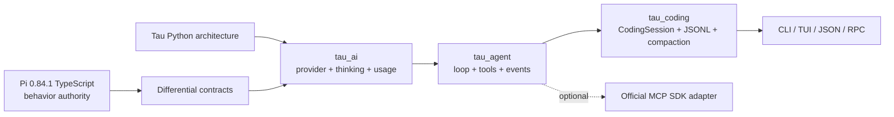

# Pi Harness Python

> A Tau-derived Python implementation of the observable coding-agent behavior in Pi 0.84.1.

[](https://www.python.org/)
[](LICENSE)
[](https://github.com/huggingface/tau)
[](https://github.com/badlogic/pi-mono)

This repository keeps Tau's readable Python layers and translates Pi's TypeScript behavior into them. It is an independent experimental derivative, not an official Pi or Tau release.

中文简介：这是一个以 Tau 为上游、按 Pi 0.84.1 源码行为翻译的 Python Agent Harness。目标是得到可读、可测试、可替换 provider 和工具的干净基座，而不是重新发明一套 Agent 框架。

## Architecture



The three original Tau boundaries remain intact:

```text
tau_ai      provider streaming, thinking, usage, replay, retry
tau_agent   model -> tools -> results -> model loop
tau_coding  prompt, resources, sessions, compaction, extensions, CLI/TUI
```

## What this branch implements

| Surface | Implemented behavior |
|---|---|
| Core loop | Ordered events, parallel/sequential tools, source-ordered results, tool validation, tool lifecycle hooks, cancellation and termination |
| Stateful harness | Separate steering/follow-up queues, one-at-a-time/all queue modes, safe continuation and settled-run ownership |
| Provider layer | Thinking blocks, reasoning-token usage, cache accounting, reasoning replay, foreign tool-call ID normalization, abortable provider retry |
| CodingSession | Append-only JSONL history, prompt/continue, retry settlement, overflow compaction/retry, branch/compaction summaries, current-state refresh before follow-on turns |
| Prompt/resources | Pi-style system-prompt semantics, recursive skills, YAML 1.2 metadata, ignore rules, prompt templates and extension-provided resources |
| Extensions | Context/prompt/provider/session/tool hooks and message replacement at the real runtime boundaries |
| Tools | Default Pi order: `read`, `bash`, `edit`, `write` |
| MCP | Optional streamable-HTTP adapter using the official Python MCP SDK; discovered tools become native `AgentTool` values |

The implementation ledger links each Python surface to its Pi source and deterministic checks: [dev-notes/pi-0.84.1-parity-ledger.md](dev-notes/pi-0.84.1-parity-ledger.md).

## Output limits and MCP are explicit

The provider layer now carries model output limits correctly. It does not impose a new global output cap. The ERP-Bench runner explicitly matches the comparison profile:

```text
context window    128,000 tokens
max model output   16,384 tokens
default tools      read, bash, edit, write
extra tools        MCP tools discovered at runtime
```

Normal Tau CLI sessions still use their selected provider/model metadata. MCP is opt-in through `McpToolSet`; it is not silently registered by the default CLI.

## Quick start

Requirements: Python 3.12+ and [`uv`](https://docs.astral.sh/uv/).

```bash
git clone https://github.com/Sanssssssssssssssss/pi-harness-python.git
cd pi-harness-python
uv sync --dev
uv run tau --version
uv run tau -p "summarize this repository"
```

Provider setup and the existing Tau UI remain available through `tau`, `/login`, and `/model`. See the [upstream Tau documentation](https://twotimespi.dev/) for those inherited surfaces.

Run the focused parity checks:

```bash
uv run pytest -q \
  tests/test_agent_loop.py \
  tests/test_agent_harness.py \
  tests/test_coding_session.py \
  tests/test_pi_loop_parity.py \
  tests/test_pi_session_retry.py \
  tests/test_message_transform.py \
  tests/test_mcp.py
uv run ruff check src tests
```

Minimal MCP use:

```python
from tau_agent import McpToolSet

async with McpToolSet("http://127.0.0.1:8000/mcp") as mcp:
    tools = mcp.tools
```

## Current evidence

Deterministic tests cover the translated loop/session contracts. A bounded real-model comparison also ran Pi and this Python harness against the same ERP-Bench task, model profile, Odoo MCP server and verifier:

| Metric | Pi 0.84.1 | Python harness |
|---|---:|---:|
| ERP-Bench reward | 100 | 100 |
| Model calls | 71 | 67 |
| MCP calls | 164 | 100 |
| Output tokens | 83,567 | 61,425 |
| Reasoning tokens | 63,089 | 47,221 |
| Agent wall time | 761.8 s | 640.0 s |

This is one task, not a quality ranking. It proves that the full model/tool/session/verifier chain can complete and leaves comparable receipts. The Python run did not trigger compaction; compaction parity is currently deterministic-test evidence only.

## Known limits

- This is behavioral translation, not a byte-for-byte or API-compatible Python port of every Pi package.
- Pi's complete TUI/protocol/client/server/telemetry ecosystem has not been reproduced; Tau's existing interfaces remain in those positions.
- The full session fork/label/migration matrix and every provider-specific streaming variant are not yet covered.
- System-prompt behavior is aligned at the core boundary, but Tau naming, documentation paths and extension seams intentionally remain.
- Dynamic mid-session model/thinking switches and some extension UI/command surfaces need more parity evidence.
- The real ERP comparison is a single bounded sample. No benchmark-wide performance claim is made.
- MCP transport is generic, but the included benchmark script is experimental and Odoo-oriented.

## Upstream and license

This repository is based on [huggingface/tau](https://github.com/huggingface/tau) commit `fc09dc8e0c82cea4642a5b93d3d231ae59787cbf` and translates behavior from Pi commit `534bcbffb7e1e7551d9ee3572dfeb278e203e493` (`@earendil-works/pi-coding-agent` 0.84.1).

Tau and Pi are MIT-licensed. The original Tau license is preserved in [LICENSE](LICENSE); translated Pi portions and attribution are documented in [THIRD_PARTY_NOTICES.md](THIRD_PARTY_NOTICES.md).
